# 📚 Spring E-Learning & Platform CBT

[](https://openjdk.org)
[](https://spring.io/projects/spring-boot)
[](https://react.dev)
[](https://tailwindcss.com)
[](https://www.postgresql.org)
[](https://redis.io)
[](https://github.com/mfarim/laravel-elearning)
[](LICENSE)

> 🇬🇧 [Read in English](README.md)
>
> 🐘 **Mencari edisi Laravel & Livewire?** Edisi monolitik pendamping yang dibangun dengan **Laravel 13, Livewire 3, dan Laravel Reverb** tersedia di: [https://github.com/mfarim/laravel-elearning](https://github.com/mfarim/laravel-elearning)

Platform web **E-Learning** dan **Computer Based Test (CBT)** tingkat enterprise berfitur lengkap untuk mengelola kegiatan pembelajaran modern antara **Admin**, **Guru**, dan **Siswa**. Dibangun dengan arsitektur terpisah (*decoupled micro-architecture*) modern: **Java 21 LTS, Spring Boot 3.4+, React 19, dan Tailwind CSS v4**, dilengkapi autentikasi stateless JWT dengan impersonasi akun, cache Redis, proctoring telemetri ujian langsung secara real-time via WebSocket STOMP, serta batch import Excel Apache POI.

---

## ✨ Fitur Utama

### 👨‍💼 Panel Admin
| Fitur | Keterangan |
|-------|------------|
| **Dashboard** | Statistik analitik menyeluruh: total guru, siswa, kelas, mata pelajaran, serta metrik CBT |
| **Manajemen Guru** | CRUD penuh dengan pembuatan akun login otomatis & validasi NIP |
| **Manajemen Siswa** | CRUD + filter kelas + **📥 Batch Import Excel** (`.xlsx`) + Cetak Kartu Peserta Ujian |
| **Manajemen Kelas** | CRUD + penugasan wali kelas + pengaturan kapasitas dan tahun ajaran |
| **Mata Pelajaran** | CRUD + kode mapel + alokasi jam/SKS + pemetaan guru pengampu |
| **Pengumuman** | CRUD + target audiens (Semua / Guru / Siswa) + tombol publikasi |
| **Impersonasi Akun** | Login instan satu-klik sebagai guru atau siswa untuk keperluan debugging & supervisi |
| **Keamanan** | Spring Security 6 stateless JWT, hashing BCrypt, dan otorisasi level method `@PreAuthorize` |

### 👨‍🏫 Panel Guru
| Fitur | Keterangan |
|-------|------------|
| **Dashboard** | Statistik mengajar, jadwal ujian CBT mendatang, tugas aktif, dan aktivitas terkini |
| **Materi Belajar** | CRUD + 5 tipe konten (Dokumen, Video, Teks, Link, Audio) + pelacakan pembaca siswa |
| **Tugas Siswa** | CRUD + tenggat waktu + petunjuk pengerjaan + penilaian submission & umpan balik |
| **Ujian CBT** | CRUD + durasi timer + KKM (passing grade) + acak soal/opsi + izin remidi (retry) |
| **Bank & Editor Soal** | Pilihan Ganda (A-E), Benar/Salah, Esai + bobot poin + **📥 Import Soal Excel** |
| **Monitor Telemetri** | Pemantauan progres pengerjaan kandidat, indikator soal terjawab, dan deteksi pelanggaran anti-cheat real-time |
| **Cetak Kartu Ujian** | Cetak kartu resmi peserta ujian CBT yang siap digunakan lengkap dengan barcode NIS |

### 👨‍🎓 Panel Siswa — Desain Mobile-First
| Fitur | Keterangan |
|-------|------------|
| **Beranda Siswa** | Menu laci responsif (*sliding drawer*), hitung mundur ujian, tugas yang harus dikumpulkan, pengumuman |
| **Modul Belajar** | Telusuri, baca, dan unduh materi pembelajaran terstruktur per mata pelajaran |
| **Pusat Tugas** | Lihat instruksi tugas + dropzone unggah file tugas + evaluasi nilai guru |
| **Ruang Ujian CBT** | Runner ujian layar penuh (*fullscreen lock*), timer sinkron, deteksi anti-cheat, dan auto-submit |
| **Transkrip & Nilai** | Ringkasan IPK/rata-rata nilai per mata pelajaran, progres bar, dan status kelulusan KKM |

### 🖥️ Alur Kerja Sistem Ujian CBT
```
Daftar Ujian → Konfirmasi & Panduan → Ruang Ujian CBT Aman
                                       ├── ⏱️ Timer Tersinkronisasi (auto-submit jika waktu habis)
                                       ├── 🔒 Anti-Cheat Proctoring (deteksi perpindahan tab & keluar fullscreen)
                                       ├── 📍 Palet Soal Warna-Warni (indikator terjawab / belum)
                                       ├── 💾 Simpan Jawaban Otomatis (pada setiap klik opsi)
                                       └── 📊 Telemetri Proctor Real-Time (dorongan WebSocket langsung ke guru)
```

---

## 📸 Tangkapan Layar

### 🔐 Halaman Login
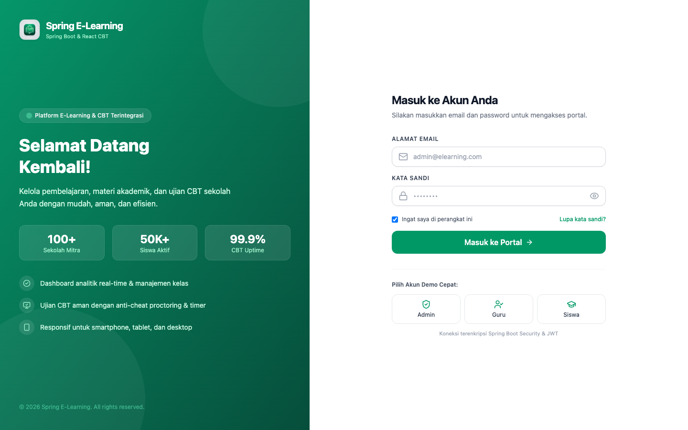

### 👨‍💼 Panel Admin

| Dashboard | Manajemen Guru |
|:---------:|:--------------:|
| 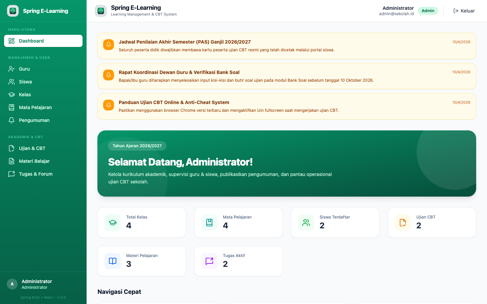 | 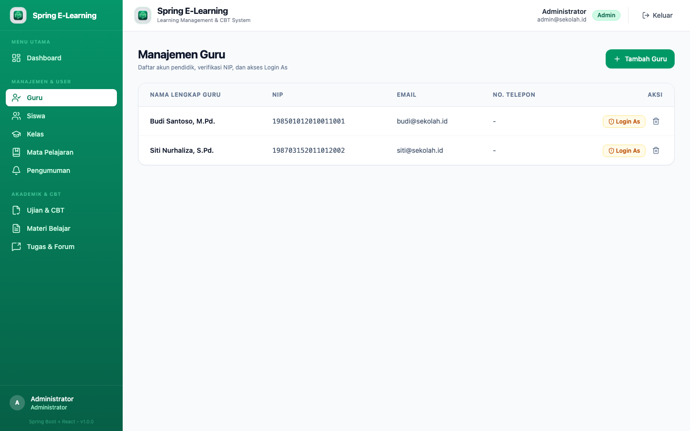 |

| Manajemen Siswa | Manajemen Kelas |
|:---------------:|:---------------:|
| 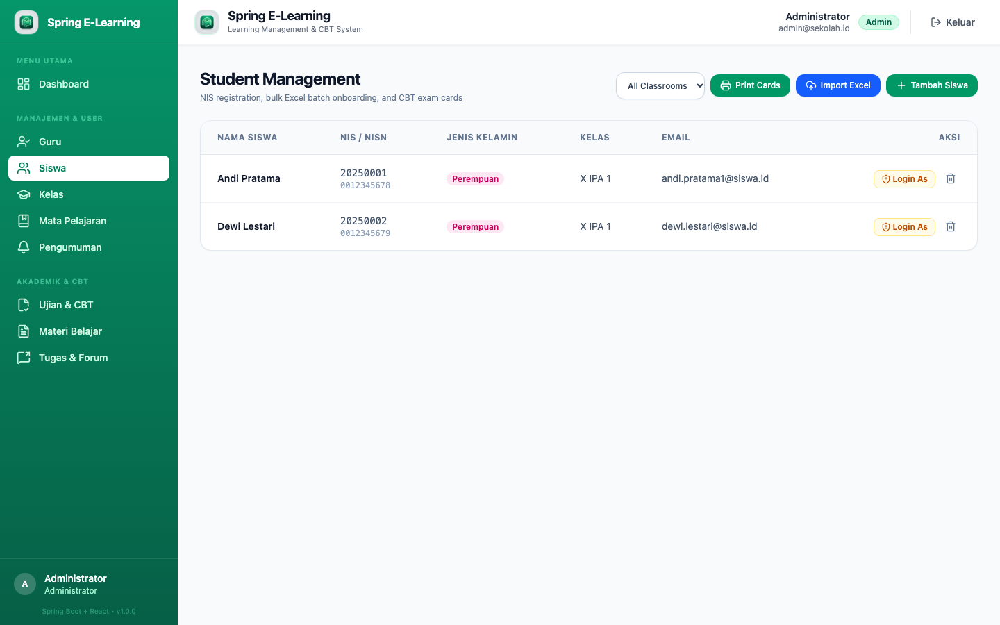 | 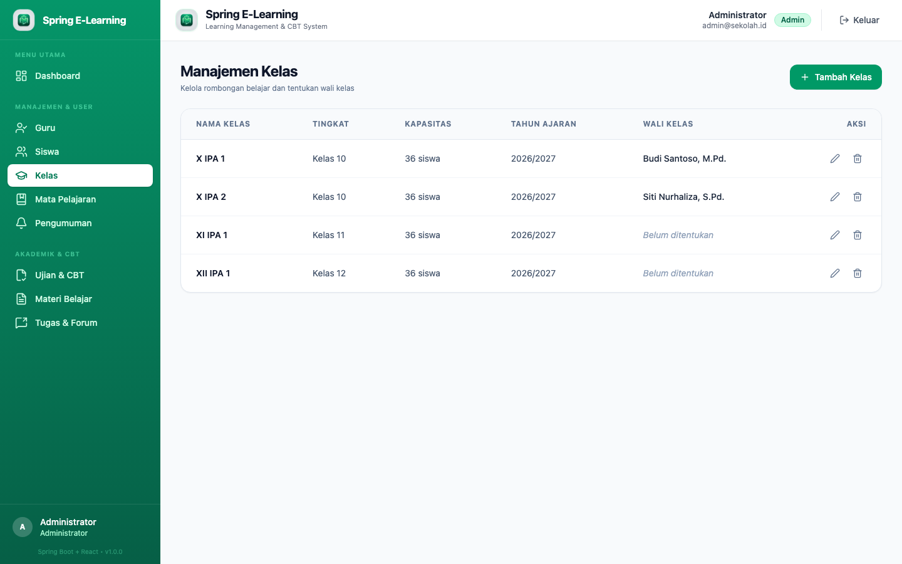 |

| Manajemen Mata Pelajaran | Pengumuman |
|:------------------------:|:----------:|
| 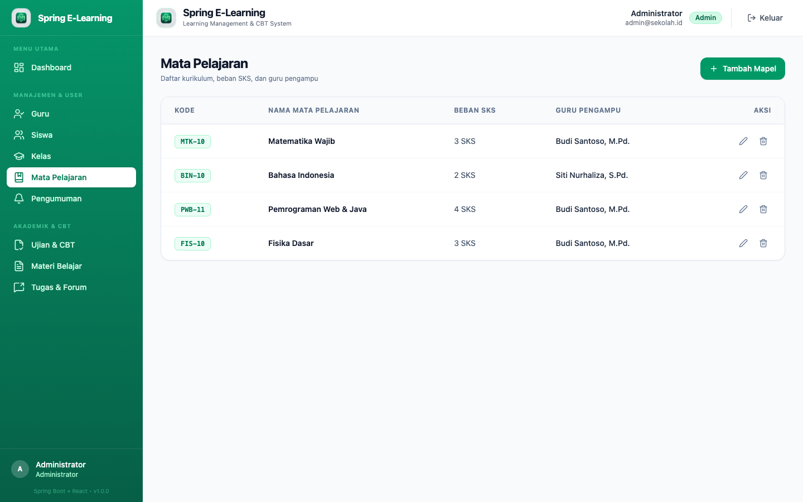 | 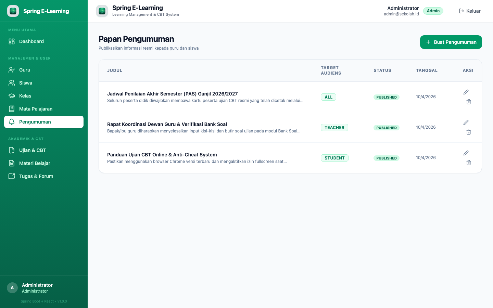 |

### 👨‍🏫 Panel Guru

| Dashboard | Materi Pembelajaran |
|:---------:|:-------------------:|
| 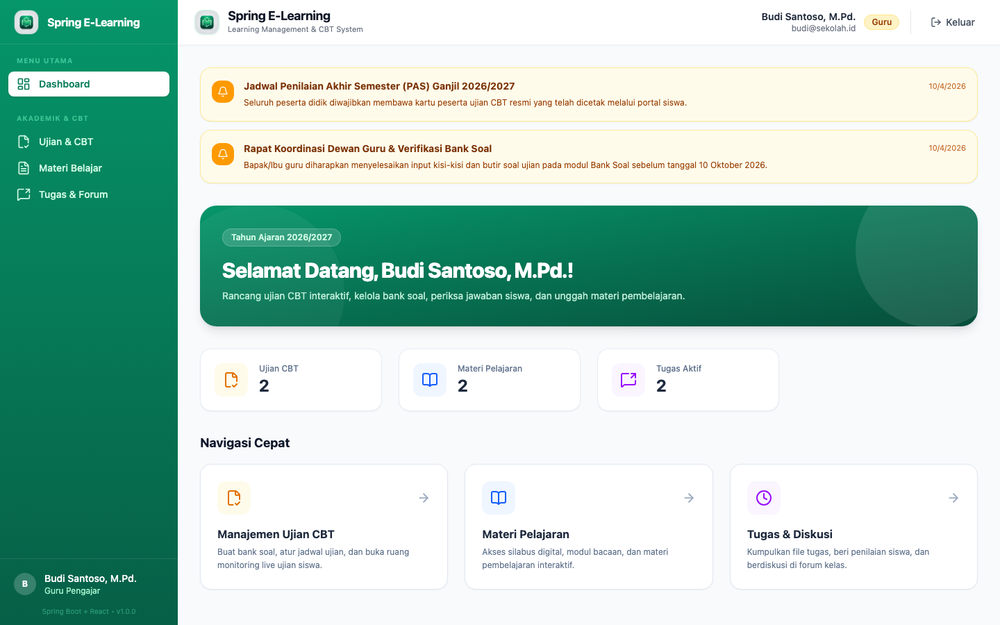 | 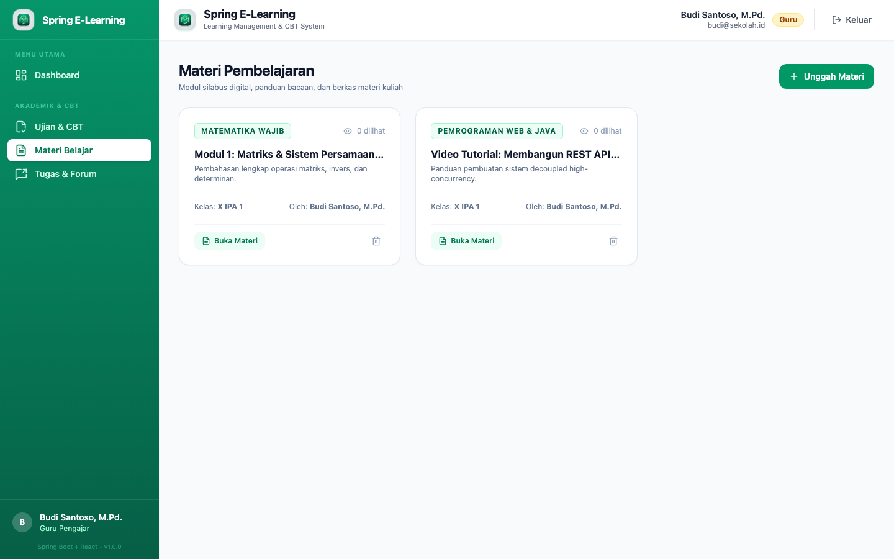 |

| Manajemen Tugas | Ujian CBT |
|:---------------:|:---------:|
| 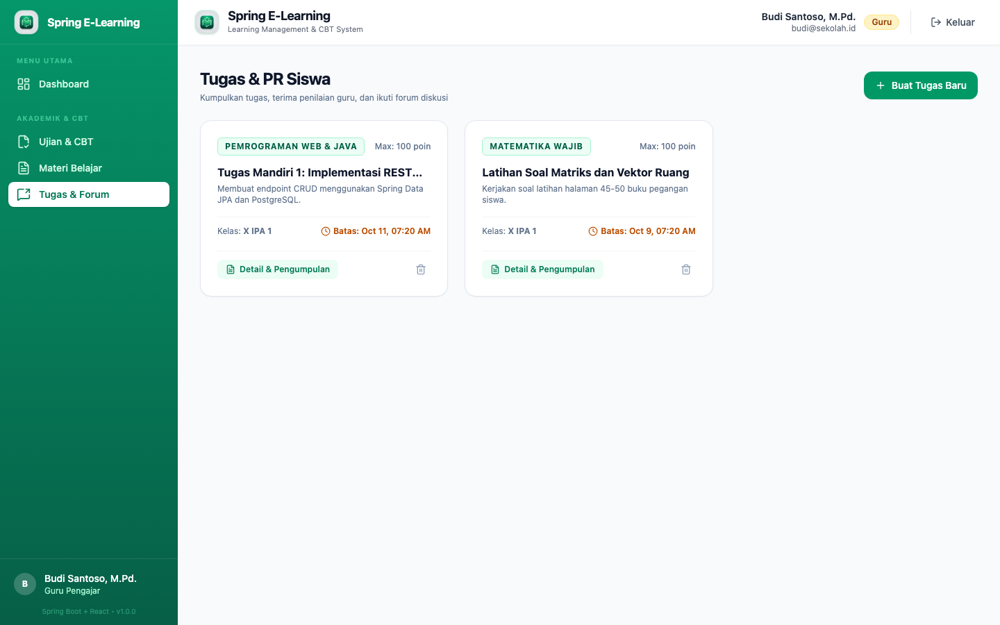 | 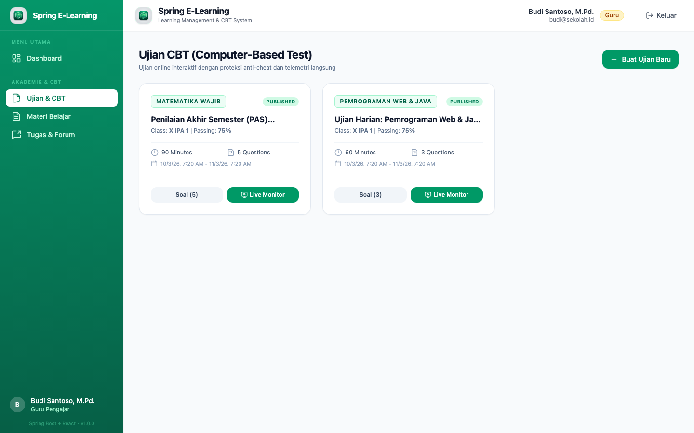 |

| Editor & Bank Soal |
|:------------------:|
|  |

### 👨‍🎓 Panel Siswa (Desain Mobile-First)

| Beranda Siswa | Materi Pembelajaran | Pusat Tugas |
|:-------------:|:-------------------:|:-----------:|
| 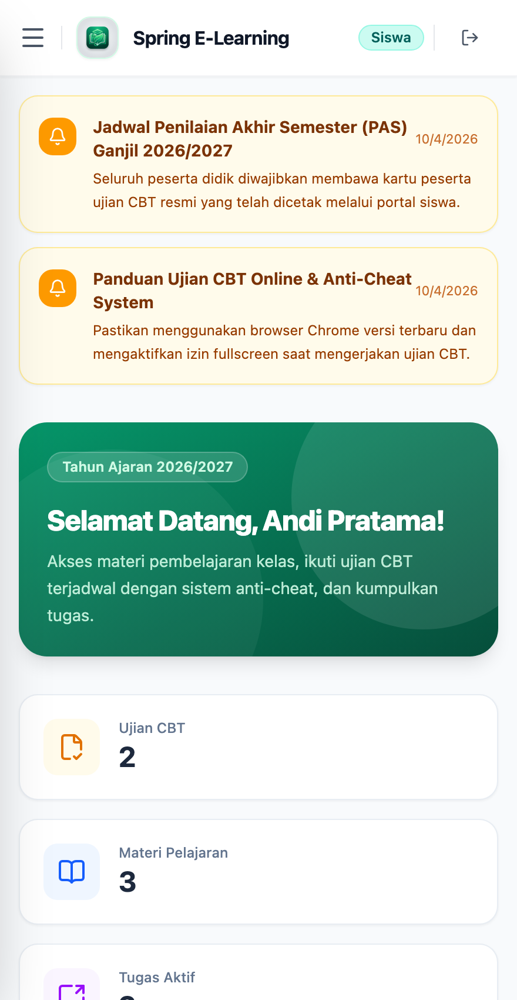 | 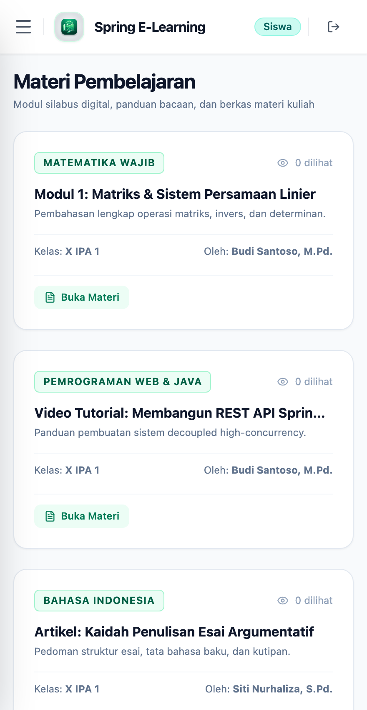 | 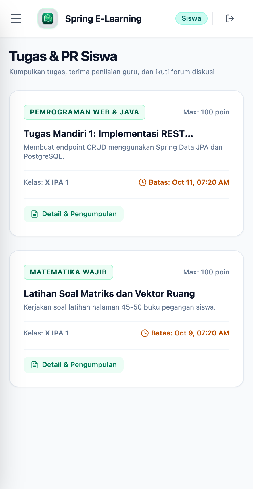 |

| Ruang Ujian CBT | Transkrip & Nilai |
|:---------------:|:-----------------:|
| 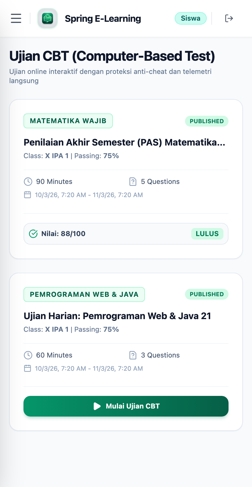 | 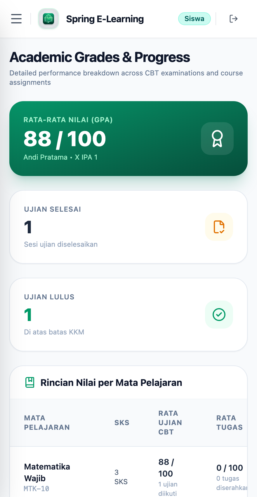 |

---

## 🛠️ Tech Stack

| Layer | Teknologi |
|-------|-----------|
| **Backend Core** | Java 21 LTS, Spring Boot 3.4.3 |
| **Keamanan & Auth** | Spring Security 6, JJWT 0.12.6, Method Security (`@PreAuthorize`), Impersonation Engine |
| **Basis Data** | PostgreSQL 16, Spring Data JPA, Hibernate 6, HikariCP, Flyway Migrations |
| **Cache & Realtime** | Redis 7, Spring WebSocket + STOMP Message Broker, SockJS |
| **Pemrosesan Berkas** | Apache POI (Parsing batch Excel `.xlsx` untuk Siswa & Bank Soal) |
| **Dokumentasi API** | Springdoc OpenAPI 3 / Swagger UI (`/swagger-ui/index.html`) |
| **Frontend Core** | React 19, TypeScript 5+, Vite 6 |
| **Styling** | Tailwind CSS v4 (Mesin Native CSS via `@tailwindcss/vite`) |
| **Manajemen State** | Zustand 5, Axios dengan interceptor token JWT |
| **Ikon & Desain** | Lucide React |
| **Deployment** | Docker Compose, Multi-stage Dockerfiles (OpenJDK 21 Alpine & Node 20 Alpine) |

---

## 🏛️ Arsitektur Sistem Tingkat Tinggi (High-Level Architecture)

Platform ini dirancang dengan arsitektur modular berlapis (*defense-in-depth decoupled micro-architecture*) yang siap di-deploy secara aman pada server VPS menggunakan Docker di balik reverse-proxy Cloudflare:

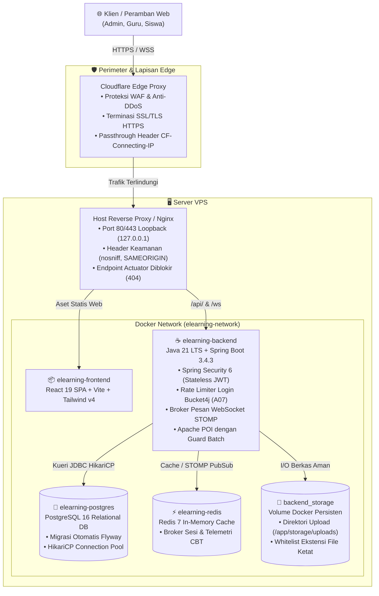

### 🔒 Keamanan Enterprise & Kepatuhan Standar OWASP Top 10

| Standar OWASP | Implementasi Mitigasi Keamanan pada Platform |
|---|---|
| **A01: Broken Access Control** | Otorisasi level method (`@PreAuthorize`) pada seluruh endpoint admin dan direktori user; validasi kepemilikan kelas untuk mencegah IDOR pada tugas dan diskusi; STOMP ChannelInterceptor memverifikasi hak akses guru/admin pada telemetri ujian. |
| **A02: Cryptographic Failures** | Hashing password dengan BCrypt; token JWT bertanda tangan HMAC-SHA256 dengan validasi minimal 256-bit key saat aplikasi booting (*fail-fast* jika `JWT_SECRET` kosong). |
| **A03: Injection** | 100% kueri parameterized melalui Spring Data JPA (mencegah SQL Injection); tidak ada eksekusi shell perintah OS; validasi DTO `@Valid`. |
| **A04: Insecure Design** | Kunci jawaban dan pembahasan disembunyikan (`null`) dari payload siswa saat ujian; durasi ujian dikalkulasi di sisi server (*server-side deadline*), tidak mempercayai jam lokal klien. |
| **A05: Security Misconfiguration** | Endpoint Actuator diblokir (`404`) dari Nginx publik; semua port Docker internal diikat ke loopback `127.0.0.1`; header keamanan HTTP (`nosniff`, `SAMEORIGIN`) aktif. |
| **A06: Vulnerable Components** | Java 21 LTS, Spring Boot 3.4.3, PostgreSQL 16, Redis 7, React 19. Multi-stage Docker container berjalan menggunakan pengguna non-root `spring:spring`. |
| **A07: Identification Failures** | **Rate Limiter Login Bucket4j**: Dibatasi maksimal 5 percobaan per menit per alamat IP (`CF-Connecting-IP` / `X-Forwarded-For`) dan per email akun, menghasilkan HTTP `429 Too Many Requests` disertai header `Retry-After`. |
| **A08: Software & Data Integrity** | Whitelist ketat ekstensi file upload (`.pdf`, `.docx`, `.xlsx`, `.jpg`, `.png`, dll); ekstensi yang dapat dieksekusi atau berisi skrip (`.html`, `.svg`, `.exe`, `.sh`) ditolak keras untuk mencegah Stored XSS; unduhan disajikan dengan `Content-Disposition` aman. |
| **A09: Logging & Monitoring** | Log pelanggaran anti-cheat ujian tercatat lengkap dengan identitas NIS siswa; probe internal `/actuator/health` tersedia untuk healthcheck container. |
| **A10: SSRF** | Tidak ada fitur backend yang melakukan pemanggilan HTTP outbound ke URL luar dari input pengguna. |

---

## 🏗️ Arsitektur Real-Time Telemetri & WebSocket

Fitur monitoring ruang ujian CBT langsung memanfaatkan **Spring WebSocket dengan message broker STOMP** yang didukung Redis untuk memantau aktivitas kandidat secara instan tanpa perlu reload halaman.

### Alur Pesan Real-Time

```
┌──────────────────┐       ┌──────────────────────┐       ┌─────────────────────┐       ┌──────────────────┐
│  Kandidat Ujian  │──────▶│   Spring Controller  │──────▶│   Redis Cache /     │       │                  │
│   di Runner CBT  │       │  /api/v1/exams/...   │       │   PostgreSQL DB     │       │   Spring STOMP   │
└──────────────────┘       └──────────┬───────────┘       └─────────────────────┘       │  Message Broker  │
                                      │                                                 │  (/ws/cbt)       │
                                      │  messagingTemplate.convertAndSend()             │                  │
                                      └────────────────────────────────────────────────▶│                  │
                                                                                        └────────┬─────────┘
                                                                                                 │
                                                                        Dorongan Telemetri Nyata │
                                                                                                 ▼
                                                                                    ┌────────────────────────┐
                                                                                    │  Monitor Pengawas Guru │
                                                                                    │  → Auto-update instan  │
                                                                                    └────────────────────────┘
```

### Komponen Kunci

| Berkas / Komponen | Fungsi |
|-------------------|--------|
| `backend/.../WebSocketConfig.java` | Konfigurasi endpoint STOMP (`/ws/cbt`) dan rute tujuan broker pesan (`/topic`, `/app`) |
| `backend/.../ExamTelemetryMessage.java` | DTO status detak jantung (*heartbeat*) siswa, progres pengerjaan, dan pelanggaran anti-cheat |
| `backend/.../ExamService.java` | Menyiarkan pesan pembaruan ketika siswa memilih jawaban, peringatan waktu, dan pengiriman ujian |
| `frontend/src/pages/exams/ExamMonitor.tsx` | Dashboard pengawas ujian dengan listener STOMP/SockJS dan kartu progres siswa |
| `frontend/src/pages/exams/ExamRunner.tsx` | Runner ujian siswa yang memantau perpindahan tab dan penguncian fullscreen |

---

## 🚀 Panduan Instalasi & Setup

### Prasyarat
- Docker & Docker Compose
- Java 21 LTS (untuk development backend lokal)
- Node.js 20+ (untuk development frontend lokal)

### Setup Cepat (Docker Compose — Direkomendasikan)

```bash
# Clone repository
git clone https://github.com/mfarim/spring-elearning-react.git
cd spring-elearning-react

# Jalankan seluruh stack (PostgreSQL 16, Redis 7, Spring Boot backend, dan React frontend)
docker compose up -d

# (Opsional) Muat data demo siap pakai (guru, kelas, mata pelajaran, ujian CBT)
docker exec -i elearning-postgres psql -U postgres -d elearning < backend/src/main/resources/db/migration/seed_demo_data.sql
```

Akses layanan:
- **Portal Web Frontend**: [http://localhost:3000](http://localhost:3000)
- **Backend API Spring Boot**: [http://localhost:8080](http://localhost:8080)
- **Actuator Health Probe**: [http://localhost:8080/actuator/health](http://localhost:8080/actuator/health)
- **Dokumentasi Swagger UI Interaktif**: [http://localhost:8080/swagger-ui/index.html](http://localhost:8080/swagger-ui/index.html)

Panduan kontribusi dan standar kode open source dapat dilihat di [CONTRIBUTING.md](CONTRIBUTING.md).

---

### Setup Manual (Pengembangan Lokal)

#### 1. Jalankan Layanan Infrastruktur
```bash
docker compose up -d postgres redis
```

#### 2. Jalankan Backend (Spring Boot)
```bash
cd backend
./mvnw clean spring-boot:run
```

#### 3. Jalankan Frontend (React + Vite)
```bash
cd frontend
npm install
npm run dev
```

---

## 🔑 Akun Demo Siap Pakai

Basis data telah terisi data awal (*seed data*) untuk setiap tingkatan hak akses:

| Peran (Role) | Email | Kata Sandi | Halaman Portal |
|--------------|-------|------------|----------------|
| **Admin** | `admin@sekolah.id` *(atau admin@elearning.com)* | `password` | `/dashboard` |
| **Guru** | `budi@sekolah.id` *(atau teacher@elearning.com)* | `password` | `/dashboard` |
| **Siswa** | `andi.pratama1@siswa.id` *(atau student@elearning.com)* | `password` | `/dashboard` |

> *Tombol Akun Demo Cepat juga tersedia langsung di halaman login untuk masuk dengan satu klik tanpa mengetik kredensial.*

---

## 📥 Format Berkas Import Siswa Excel

Modul impor batch siswa menerima berkas spreadsheet `.xlsx` standar dengan susunan kolom:

| Nama Kolom | Wajib | Contoh Nilai | Keterangan |
|------------|:-----:|--------------|------------|
| **Name** | ✅ | Andi Pratama | Nama lengkap siswa |
| **Email** | ✅ | andi@siswa.id | Email unik untuk akun login |
| **NIS** | ✅ | 20250001 | Nomor Induk Siswa (kode barcode kartu ujian) |
| **Classroom** | ✅ | X IPA 1 | Nama kelas tujuan |
| **NISN** | ➖ | 0012345678 | Nomor Induk Siswa Nasional |
| **Gender** | ➖ | L / P *(atau M / F)* | Jenis kelamin siswa |
| **Address** | ➖ | Jl. Merdeka No. 45 | Alamat domisili tempat tinggal |

---

## 🧪 Pengujian & Validasi

### Pengujian Backend
```bash
cd backend
./mvnw test
```

### Build & Pengecekan Type Frontend
```bash
cd frontend
npm run build
```

---

## 📂 Struktur Folder Proyek

```
java-spring-react-elearning/
├── backend/
│   ├── src/main/java/com/elearning/
│   │   ├── config/              # Konfigurasi Security, JWT, WebSocket, Redis, Swagger
│   │   ├── common/              # Wrapper respon API, exceptions handler, paginasi
│   │   └── modules/
│   │       ├── academic/        # Modul Kelas, Mata Pelajaran, Pengumuman
│   │       ├── user/            # Pengguna, Guru, Siswa, Impersonasi
│   │       ├── learning/        # Materi Pembelajaran & Riwayat Pembaca
│   │       ├── assignment/      # Tugas, Pengumpulan Tugas, Forum Diskusi
│   │       └── exam/            # Ujian CBT, Bank Soal, Telemetri, Hasil Ujian
│   └── src/main/resources/
│       ├── db/migration/        # Flyway migrasi skema SQL & seeder demo data
│       └── application.yml      # Konfigurasi profil Spring Boot
├── frontend/
│   ├── public/                  # Favicon, Logo Aplikasi, Gambar Banner OG SEO
│   ├── src/
│   │   ├── api/                 # Klien HTTP Axios dengan interceptor otomatis JWT
│   │   ├── components/          # Tata letak Layout, Sidebar, Top Navbar, ProtectedRoute
│   │   ├── pages/               # Halaman Admin, Guru, Siswa, CBT Runner, Exam Monitor
│   │   ├── store/               # Zustand autentikasi & manajemen status
│   │   └── types/               # Tipe interface TypeScript & skema DTO
│   ├── index.html               # Semantik HTML dengan metadata OpenGraph & JSON-LD
│   └── vite.config.ts           # Konfigurasi Vite 6 dengan Tailwind CSS v4 native
├── screenshots/                 # Dokumentasi visual antarmuka sistem per peran
└── docker-compose.yml           # Orkestrasi container Docker multi-service
```

---

## 🚢 Panduan Deployment ke Production

Untuk menerapkan ke server production:
1. Manfaatkan berkas multi-stage Dockerfile teroptimasi di `backend/Dockerfile` dan `frontend/Dockerfile`.
2. Arahkan koneksi PostgreSQL dan Redis ke server database production melalui variabel lingkungan (`SPRING_DATASOURCE_URL`, `SPRING_DATA_REDIS_HOST`).
3. Tentukan kunci rahasia token JWT (`JWT_SECRET`) minimal 256-bit acak.
4. Gunakan Nginx atau Cloudflare sebagai reverse proxy dengan enkripsi SSL/TLS dan pastikan mengaktifkan penerusan header WebSocket (`Upgrade` dan `Connection`).

---

## 📄 Lisensi

Proyek ini adalah perangkat lunak open-source yang dilisensikan di bawah [lisensi MIT](LICENSE).
