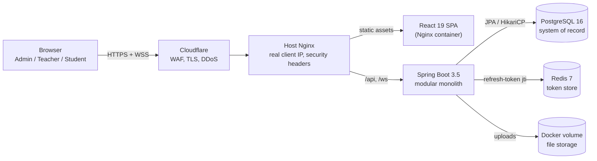
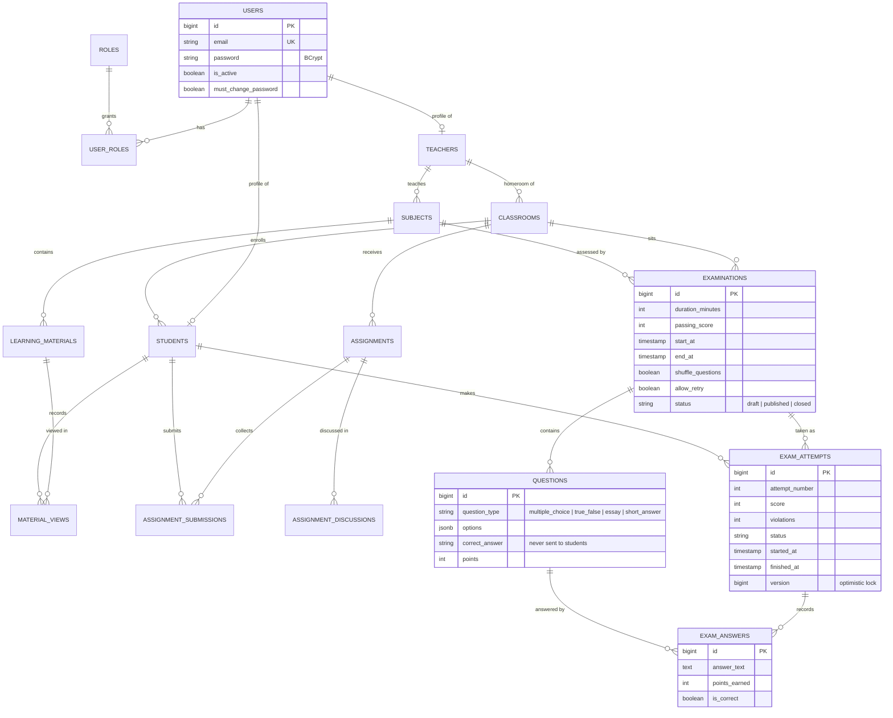
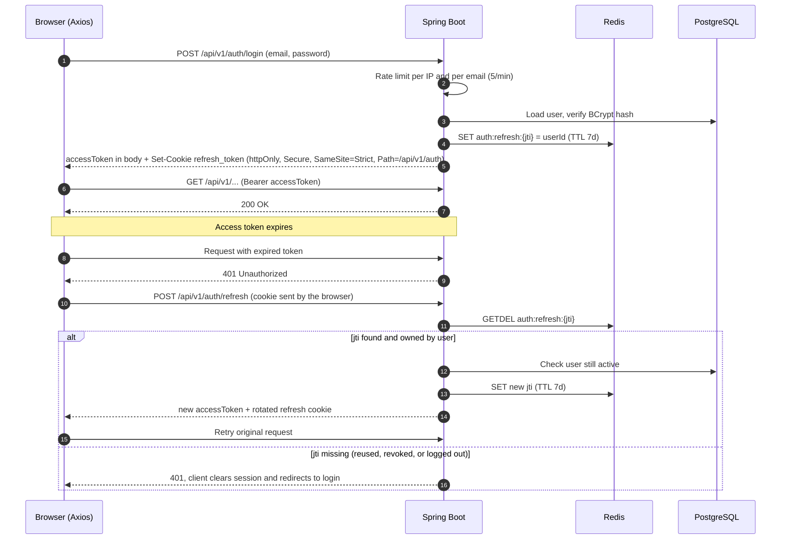
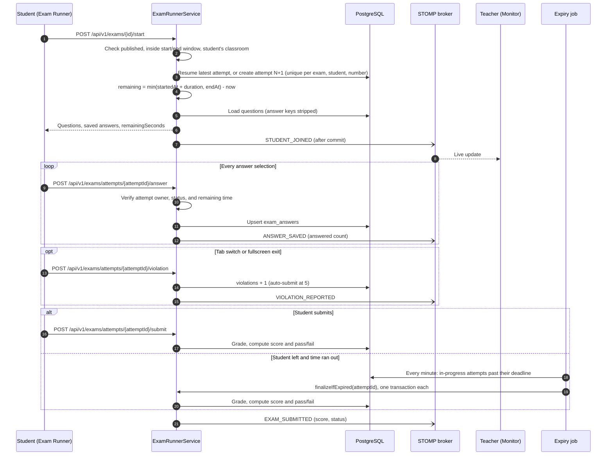
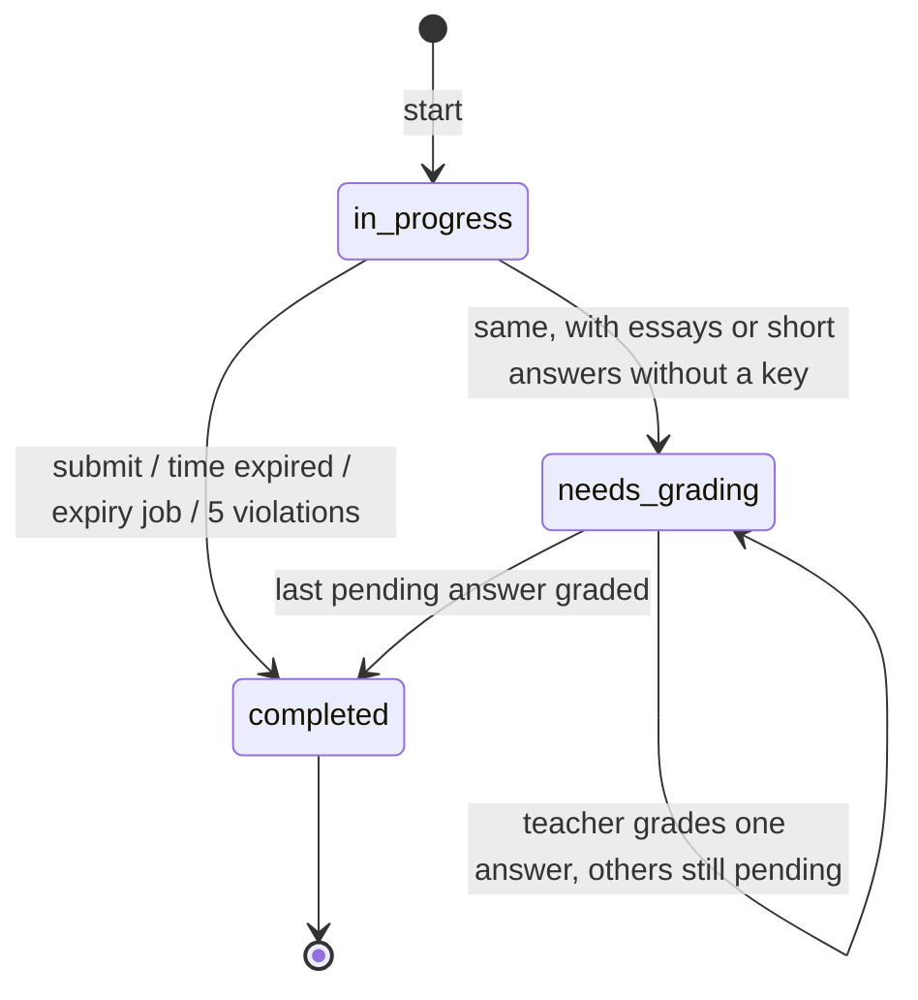

# Architecture

This document explains how the platform is built, why it is built that way, and where its limits are. It complements the [README](../README.md), which covers features, setup, and deployment.

**Contents**

1. [System context](#system-context)
2. [Backend modules](#backend-modules)
3. [Data model](#data-model)
4. [Authentication and token rotation](#authentication-and-token-rotation)
5. [Exam lifecycle](#exam-lifecycle)
6. [Real-time proctoring](#real-time-proctoring)
7. [Design decisions](#design-decisions)
8. [Scaling limits and roadmap](#scaling-limits-and-roadmap)
9. [Testing strategy](#testing-strategy)
10. [Operations](#operations)

---

## System context

One Spring Boot service (a **modular monolith**) serves the REST API and the WebSocket endpoint. A React SPA is served as static files by Nginx. Everything runs as Docker containers on a single VPS behind Cloudflare.

| Component | Responsibility |
| --- | --- |
| Cloudflare | TLS termination, WAF, DDoS protection, forwards `CF-Connecting-IP` |
| Host Nginx | Restores the real client IP, adds security headers, blocks Actuator, routes `/api` and `/ws` to the backend |
| Spring Boot | REST API, JWT security, business rules, STOMP broker (in-memory), expired-attempt job, Excel import, file I/O |
| PostgreSQL | All business data; schema owned by Flyway migrations |
| Redis | Refresh-token registry (rotation, logout, revoke-all); optionally shared rate-limit counters and cross-instance exam events |
| Docker volume or S3 | Uploaded materials and assignment files (`app.storage.type=local` or `s3` for AWS S3 / MinIO) |

---

## Backend modules

Code is organised by domain (`modules/<domain>/{controller,service,repository,entity,dto}`) rather than by technical layer, so each module can later be extracted into its own service with minimal changes.

| Package | Responsibility |
| --- | --- |
| `modules/auth` | Login, refresh, logout, change password, impersonation |
| `modules/user` | Users, teachers, students, roles |
| `modules/academic` | Classrooms and subjects |
| `modules/announcement` | Targeted announcements (all, teacher, student) |
| `modules/material` | Learning materials and view tracking |
| `modules/assignment` | Assignments, submissions, threaded discussions |
| `modules/exam` | Exams, question bank, attempts, answers, auto-grading, real-time events |
| `modules/grade` | Grade summaries |
| `security` | JWT provider and filter, refresh-token store, rate limiting, forced password change |
| `config` | Spring Security filter chain, WebSocket/STOMP configuration and channel authorization |
| `common` | Base entity, API response wrapper, global exception handler, file storage |

Request path inside the backend: `RateLimitingFilter` → `JwtAuthenticationFilter` → `PasswordChangeRequiredFilter` → controller (`@PreAuthorize`) → service (ownership checks, `@Transactional`) → repository.

---

## Data model

Simplified ERD of the main tables (from `V1__initial_schema.sql`). Every user has one or more roles; teacher and student profiles extend a user one-to-one.

Integrity rules enforced by the database:

- `UNIQUE (exam_attempt_id, question_id)`: one answer row per question per attempt, so auto-save is an upsert.
- `UNIQUE (examination_id, student_id, attempt_number)` (V3): concurrent "start" requests cannot create duplicate attempts.
- `UNIQUE (assignment_id, student_id)` and `UNIQUE (learning_material_id, student_id)`: one submission and one view record per student.
- `CHECK` constraints on every status and type column, plus `ON DELETE CASCADE` / `SET NULL` chosen per relation.
- Soft delete (`deleted_at`) on content tables such as exams, questions, and announcements.

---

## Authentication and token rotation

Access tokens are short-lived (15 minutes) and stateless. Refresh tokens last 7 days, are registered in Redis by their `jti`, can be used **exactly once**, and are never visible to JavaScript: the backend sets them as an httpOnly cookie that only the auth endpoints receive.

Why this design:

- **Stateless access tokens** keep every API call free of a database or Redis lookup.
- **Rotation with an atomic `GETDEL`** means a stolen refresh token can be used at most once, and reuse is detected because the legitimate client's next refresh fails.
- **httpOnly refresh cookie**: an XSS bug cannot read the refresh token and keep minting sessions. `SameSite=Strict` and the `/api/v1/auth` path keep the cookie off cross-site requests and every other endpoint. The 15-minute access token in `localStorage` is the remaining exposure, narrowed further by the Content-Security-Policy.
- **Revoke-all on password change** deletes every `jti` of the user, logging out all devices; logout revokes the token and clears the cookie.
- Access and refresh tokens carry a `typ` claim, so one can never be used in place of the other.
- Impersonation stores the admin's ID as a claim, so actions are traceable and "stop impersonating" returns to the admin session.

---

## Exam lifecycle

All timing rules are enforced on the server. The client timer is only a display.

Attempt states:

Grading rules (`AnswerGrader`, pure and unit tested):

- Multiple choice and true/false: case-insensitive match against the stored key.
- Short answer: compared after normalization (accents removed, lower case, whitespace collapsed, punctuation at both ends dropped). Teachers can accept several answers with `|`, for example `Jakarta|DKI Jakarta`. A short answer with no key goes to manual grading like an essay.
- Essays: scored 0 until a teacher grades them, with points validated between 0 and the question's maximum. The attempt stays `needs_grading` until every pending answer has a grade.
- `score = earned points * 100 / total points` (rounded down), compared with the exam's passing score.
- Question and option shuffling use a seed derived from the attempt ID, so the order stays the same when a student reloads the page.

Consistency rules:

- **Expired attempts are finalized even when the request is rejected.** Resuming or saving after the deadline grades the attempt and throws `AttemptExpiredException`; the transaction is declared `noRollbackFor` that exception, so the result is committed.
- **No duplicate attempts.** `UNIQUE (examination_id, student_id, attempt_number)` rejects a second concurrent "start"; the controller retries once, which resumes the attempt that won.
- **No double grading.** `exam_attempts.version` (`@Version`) makes a student's submit and the expiry job (or two instances) race safely: one update wins, the other gets a conflict.

---

## Real-time proctoring

The teacher's monitor subscribes to `/topic/exams/{examId}/monitor`. Events are sent **after the transaction commits**, so the monitor never shows an answer or score that was rolled back, and it can always be rebuilt from a REST call.

Channel security (`WebSocketConfig` `ChannelInterceptor`):

- `CONNECT` requires a valid access token; inactive or deleted users are rejected.
- `SUBSCRIBE` is deny-by-default: only the owning teacher or an admin may subscribe to an exam's monitor topic, and wildcard destinations are rejected.
- Clients cannot `SEND` directly to broker destinations.

Delivery modes (`app.realtime.mode`):

- `local` (default): Spring's in-memory simple broker of the instance that handled the request.
- `redis`: the event is published to the Redis channel `elearning:exam-events`; every instance subscribes and relays it to its own broker, so a teacher connected to any instance receives it. If Redis is unreachable the event falls back to local delivery.

---

## Design decisions

| Decision | Alternatives considered | Why |
| --- | --- | --- |
| Modular monolith | Microservices | One team and one deployable; domain packages keep boundaries clear and allow later extraction without paying the cost of distributed systems now. |
| Stateless JWT + refresh tokens in Redis | Server-side sessions; JWT without a store | Stateless requests for the hot path, while logout, rotation, and revoke-all still work. |
| Refresh token in an httpOnly cookie | Refresh token in `localStorage` | Not readable by injected scripts; scoped to the auth endpoints with `SameSite=Strict`. |
| In-memory STOMP broker + Redis pub/sub fan-out | STOMP broker relay (RabbitMQ / ActiveMQ) | Reuses the Redis that is already deployed; no new broker to run. A relay remains an option if message volume grows. |
| Background expiry job + optimistic locking | Finalize only when the student returns | Results appear on time even if the student closed the browser; `@Version` keeps it safe with several instances, without a distributed lock. |
| PostgreSQL + Flyway | MongoDB; Hibernate `ddl-auto` | Strongly relational data (classes, enrollments, attempts) and constraints; versioned, reviewable migrations. |
| JSONB for question options | Separate `question_options` table | Options are always read and written together with the question. |
| Server-side timing and grading | Trusting the client timer and answers | The client is untrusted; deadlines and scores must be computed where students cannot tamper with them. |
| Pluggable storage (disk or S3) behind one service | Writing S3 code in each feature | Validation (extensions, random names, path traversal) stays in one place for every backend. |
| Docker Compose on a VPS behind Cloudflare | Kubernetes; managed PaaS | Low, predictable cost; Cloudflare adds TLS and DDoS protection without extra servers. |

---

## Scaling limits and roadmap

The default configuration targets **one backend instance**, which fits a school-sized load. Running several instances behind a load balancer needs these settings:

| Concern | Setting | Effect |
| --- | --- | --- |
| Live monitor events | `APP_REALTIME_MODE=redis` | Events reach teachers on every instance |
| Rate limits | `APP_RATE_LIMIT_STORE=redis` | One shared counter per key (fixed window, fails open if Redis is down) |
| Uploaded files | `APP_STORAGE_TYPE=s3` plus `APP_STORAGE_S3_*` | All instances read and write the same bucket (AWS S3, MinIO with `APP_STORAGE_S3_PATH_STYLE=true`) |
| Expired attempts | nothing to change | Every instance may run the job; `@Version` lets one win per attempt |
| WebSocket fallbacks | sticky sessions on the load balancer | SockJS fallback transports (when WebSocket is blocked) keep state on one instance |

Still open:

- `LocalDateTime` with the server time zone; moving to `Instant` / `timestamptz` in UTC would remove ambiguity across regions.
- The access token lives in `localStorage` for 15 minutes; keeping it in memory with a silent refresh on page load would close that gap.
- Integration tests with Testcontainers for the full login and exam flow, and a frontend test suite.
- A later migration to Spring Boot 4.

---

## Testing strategy

| Level | Current | Planned |
| --- | --- | --- |
| Unit | Grading rules (`AnswerGrader`); exam flow in `ExamRunnerService` (scoring, manual grading, deadlines, retries, expiry job); refresh-token store rotation and reuse; refresh cookie attributes; in-memory and Redis rate limiters; real-time delivery (after commit, Redis fan-out, fallback); S3 storage; file key validation; JWT provider; file storage path traversal | More service coverage (assignments, materials) |
| Integration | Application context test against PostgreSQL and Redis in CI | Testcontainers tests for login, refresh reuse detection, and the full exam flow |
| Coverage | JaCoCo report on every CI run (summary in the job, HTML as an artifact) | Coverage threshold once the integration suite exists |
| Frontend | Type check, lint, and production build in CI | Component tests for the exam runner and the token refresh interceptor |
| Security | Dependabot for Maven, npm, Docker, and GitHub Actions; Content-Security-Policy on the SPA | `npm audit` and OWASP dependency check in CI; OWASP ZAP baseline scan against the demo instance |

---

## Operations

- **CI:** GitHub Actions builds and tests the backend (with PostgreSQL and Redis service containers) and builds the frontend on every push and pull request.
- **Deploy:** `deploy.sh` with `docker-compose.prod.yml`; required settings (`JWT_SECRET`, CORS origins, demo mode, registration, Swagger) are listed in the README.
- **Health:** `/actuator/health` for container health checks; Actuator is not exposed publicly.
- **Background jobs:** the expired-attempt finalizer runs every minute (`APP_EXAM_FINALIZER_INTERVAL_MS`) and logs how many attempts it finalized.
- **Logs:** application logs at INFO, with warnings for rate-limit hits, rejected WebSocket connections, and exam violations.
- **Dependencies:** Dependabot keeps Maven, npm, Docker, and GitHub Actions versions current.
