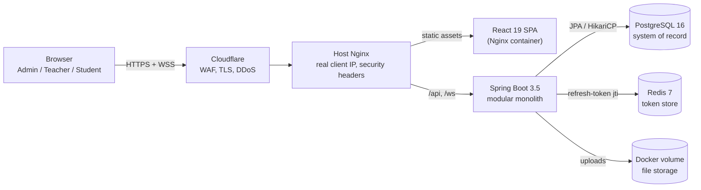
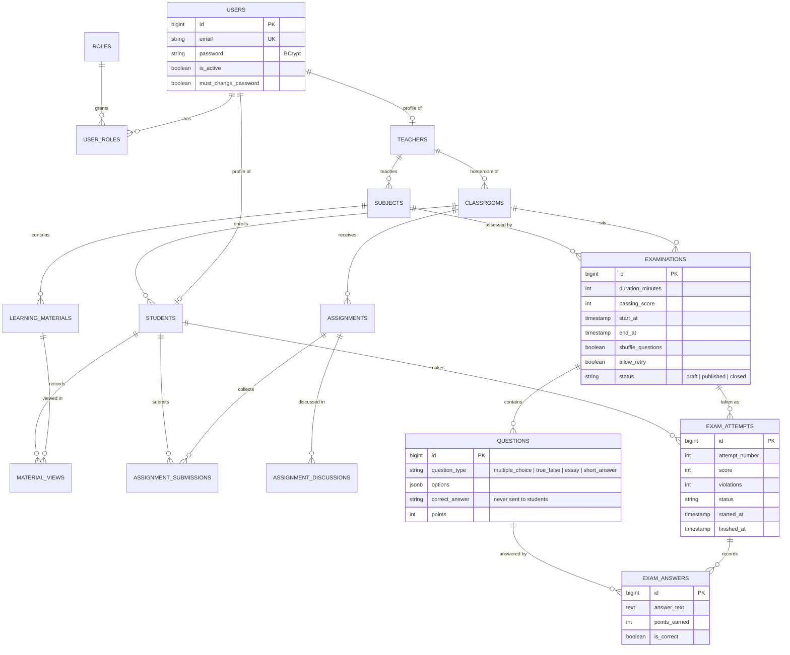
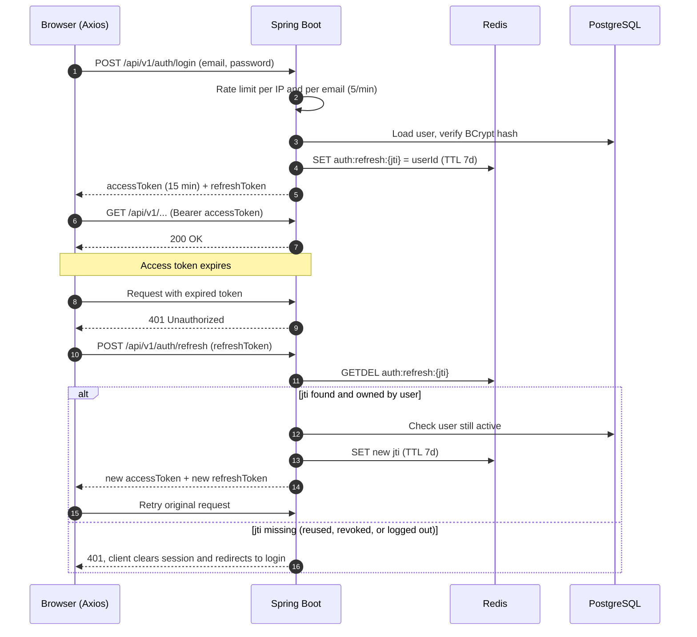
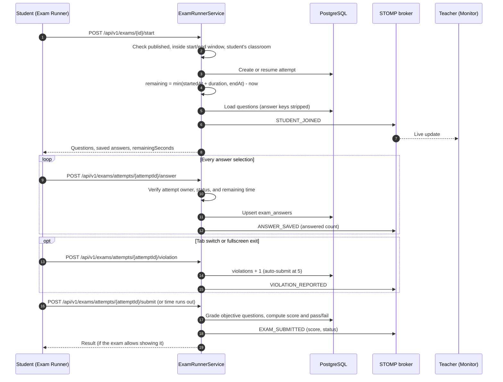
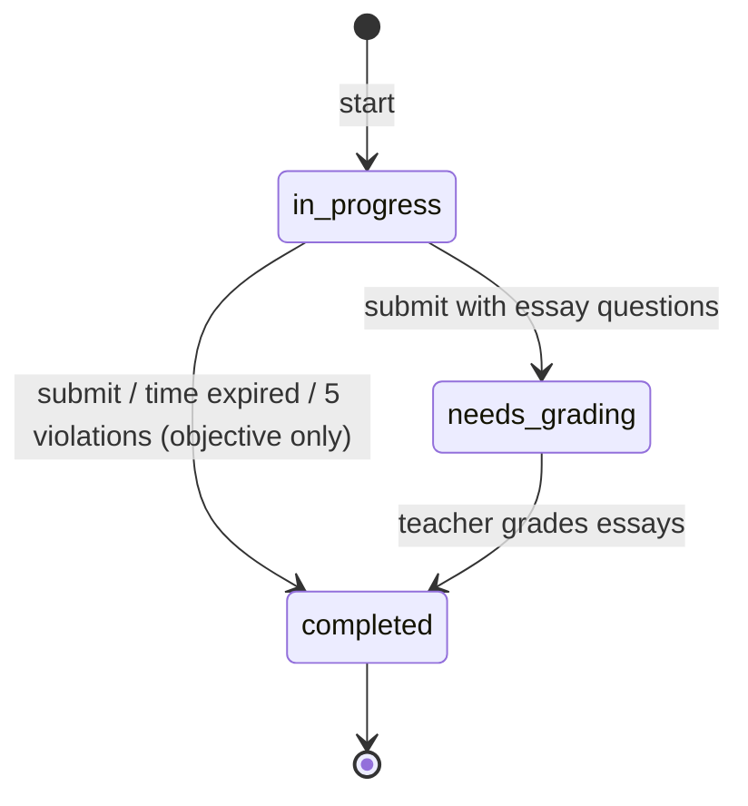

# Architecture

This document explains how the platform is built, why it is built that way, and where its limits are. It complements the [README](../README.md), which covers features, setup, and deployment.

**Contents**

1. [System context](#system-context)
2. [Backend modules](#backend-modules)
3. [Data model](#data-model)
4. [Authentication and token rotation](#authentication-and-token-rotation)
5. [Exam lifecycle](#exam-lifecycle)
6. [Real-time proctoring](#real-time-proctoring)
7. [Design decisions](#design-decisions)
8. [Scaling limits and roadmap](#scaling-limits-and-roadmap)
9. [Testing strategy](#testing-strategy)
10. [Operations](#operations)

---

## System context

One Spring Boot service (a **modular monolith**) serves the REST API and the WebSocket endpoint. A React SPA is served as static files by Nginx. Everything runs as Docker containers on a single VPS behind Cloudflare.

| Component | Responsibility |
| --- | --- |
| Cloudflare | TLS termination, WAF, DDoS protection, forwards `CF-Connecting-IP` |
| Host Nginx | Restores the real client IP, adds security headers, blocks Actuator, routes `/api` and `/ws` to the backend |
| Spring Boot | REST API, JWT security, business rules, STOMP broker (in-memory), Excel import, file I/O |
| PostgreSQL | All business data; schema owned by Flyway migrations |
| Redis | Refresh-token registry only (rotation, logout, revoke-all) |
| Docker volume | Uploaded materials and assignment files |

---

## Backend modules

Code is organised by domain (`modules/<domain>/{controller,service,repository,entity,dto}`) rather than by technical layer, so each module can later be extracted into its own service with minimal changes.

| Package | Responsibility |
| --- | --- |
| `modules/auth` | Login, refresh, logout, change password, impersonation |
| `modules/user` | Users, teachers, students, roles |
| `modules/academic` | Classrooms and subjects |
| `modules/announcement` | Targeted announcements (all, teacher, student) |
| `modules/material` | Learning materials and view tracking |
| `modules/assignment` | Assignments, submissions, threaded discussions |
| `modules/exam` | Exams, question bank, attempts, answers, auto-grading, real-time events |
| `modules/grade` | Grade summaries |
| `security` | JWT provider and filter, refresh-token store, rate limiting, forced password change |
| `config` | Spring Security filter chain, WebSocket/STOMP configuration and channel authorization |
| `common` | Base entity, API response wrapper, global exception handler, file storage |

Request path inside the backend: `RateLimitingFilter` → `JwtAuthenticationFilter` → `PasswordChangeRequiredFilter` → controller (`@PreAuthorize`) → service (ownership checks, `@Transactional`) → repository.

---

## Data model

Simplified ERD of the main tables (from `V1__initial_schema.sql`). Every user has one or more roles; teacher and student profiles extend a user one-to-one.

Integrity rules enforced by the database:

- `UNIQUE (exam_attempt_id, question_id)`: one answer row per question per attempt, so auto-save is an upsert.
- `UNIQUE (assignment_id, student_id)` and `UNIQUE (learning_material_id, student_id)`: one submission and one view record per student.
- `CHECK` constraints on every status and type column, plus `ON DELETE CASCADE` / `SET NULL` chosen per relation.
- Soft delete (`deleted_at`) on content tables such as exams, questions, and announcements.

---

## Authentication and token rotation

Access tokens are short-lived (15 minutes) and stateless. Refresh tokens last 7 days, but each one is registered in Redis by its `jti` and can be used **exactly once**.

Why this design:

- **Stateless access tokens** keep every API call free of a database or Redis lookup.
- **Rotation with an atomic `GETDEL`** means a stolen refresh token can be used at most once, and reuse is detected because the legitimate client's next refresh fails.
- **Revoke-all on password change** deletes every `jti` of the user, logging out all devices.
- Access and refresh tokens carry a `typ` claim, so one can never be used in place of the other.
- Impersonation stores the admin's ID as a claim, so actions are traceable and "stop impersonating" returns to the admin session.

---

## Exam lifecycle

All timing rules are enforced on the server. The client timer is only a display.

Attempt states:

Grading rules:

- Multiple choice and true/false are graded automatically (case-insensitive match against the stored key).
- Essays are scored 0 until a teacher grades them; points are validated to stay between 0 and the question's maximum.
- `score = earned points * 100 / total points`, compared with the exam's passing score.
- Question and option shuffling use a seed derived from the attempt ID, so the order stays the same when a student reloads the page.

---

## Real-time proctoring

The teacher's monitor subscribes to `/topic/exams/{examId}/monitor`. Events are published by the service layer **after** the change is saved, so the database stays the source of truth and the monitor can always be rebuilt from a REST call.

Channel security (`WebSocketConfig` `ChannelInterceptor`):

- `CONNECT` requires a valid access token; inactive or deleted users are rejected.
- `SUBSCRIBE` is deny-by-default: only the owning teacher or an admin may subscribe to an exam's monitor topic, and wildcard destinations are rejected.
- Clients cannot `SEND` directly to broker destinations.

The broker is Spring's **in-memory simple broker**, which is enough for a single instance (see the limits below).

---

## Design decisions

| Decision | Alternatives considered | Why |
| --- | --- | --- |
| Modular monolith | Microservices | One team and one deployable; domain packages keep boundaries clear and allow later extraction without paying the cost of distributed systems now. |
| Stateless JWT + refresh tokens in Redis | Server-side sessions; JWT without a store | Stateless requests for the hot path, while logout, rotation, and revoke-all still work. |
| In-memory STOMP simple broker | Redis or RabbitMQ broker relay | No extra infrastructure for a single instance. The service code does not change when switching to a relay. |
| PostgreSQL + Flyway | MongoDB; Hibernate `ddl-auto` | Strongly relational data (classes, enrollments, attempts) and constraints; versioned, reviewable migrations. |
| JSONB for question options | Separate `question_options` table | Options are always read and written together with the question. |
| Server-side timing and grading | Trusting the client timer and answers | The client is untrusted; deadlines and scores must be computed where students cannot tamper with them. |
| Docker Compose on a VPS behind Cloudflare | Kubernetes; managed PaaS | Low, predictable cost; Cloudflare adds TLS and DDoS protection without extra servers. |

---

## Scaling limits and roadmap

The current deployment targets **one backend instance**, which fits a school-sized load. These parts hold state in memory or on local disk and are the first things to change before running several instances:

| Today | Limit | Next step |
| --- | --- | --- |
| STOMP simple broker (in-memory) | Events published on instance A never reach teachers connected to instance B | Spring `enableStompBrokerRelay` with RabbitMQ (STOMP plugin), or Redis pub/sub fan-out |
| Rate-limit buckets in Caffeine | Each instance counts separately, so the effective limit multiplies | Bucket4j with a Redis-backed proxy manager |
| Uploads on a Docker volume | Files exist on one host only | S3-compatible object storage (MinIO / S3) with pre-signed download URLs |
| Expired attempts finalized on the next request | An abandoned attempt stays `in_progress` until the student returns | Scheduled job that finalizes attempts past their deadline |
| `short_answer` questions are not auto-graded | They currently earn 0 points | Normalized text matching, or route them to manual grading like essays |
| Concurrent "start" requests | Two simultaneous requests could create two attempts | Unique constraint on `(examination_id, student_id, attempt_number)` plus retry |
| `LocalDateTime` with the server time zone | Ambiguous if servers run in different zones | Store `Instant` / `timestamptz` in UTC |

Other planned improvements: refresh token in an `httpOnly` cookie instead of `localStorage`, a Content-Security-Policy header, and a later migration to Spring Boot 4.

---

## Testing strategy

| Level | Current | Planned |
| --- | --- | --- |
| Unit | JWT provider (access vs refresh token types, invalid signature, unique `jti`, publicly known secret rejected) and file storage (path traversal, dangerous extensions) | Grading and timing rules in `ExamRunnerService`, refresh-token rotation |
| Integration | Application context test against PostgreSQL and Redis in CI | Testcontainers tests for login, refresh reuse detection, and the full exam flow; JaCoCo coverage report |
| Frontend | Type check and production build in CI | Component tests for the exam runner and the token refresh interceptor |
| Security | Dependabot for Maven, npm, Docker, and GitHub Actions | `npm audit` and OWASP dependency check in CI; OWASP ZAP baseline scan against the demo instance |

---

## Operations

- **CI:** GitHub Actions builds and tests the backend (with PostgreSQL and Redis service containers) and builds the frontend on every push and pull request.
- **Deploy:** `deploy.sh` with `docker-compose.prod.yml`; required settings (`JWT_SECRET`, CORS origins, demo mode, registration, Swagger) are listed in the README.
- **Health:** `/actuator/health` for container health checks; Actuator is not exposed publicly.
- **Logs:** application logs at INFO, with warnings for rate-limit hits, rejected WebSocket connections, and exam violations.
- **Dependencies:** Dependabot keeps Maven, npm, Docker, and GitHub Actions versions current.
